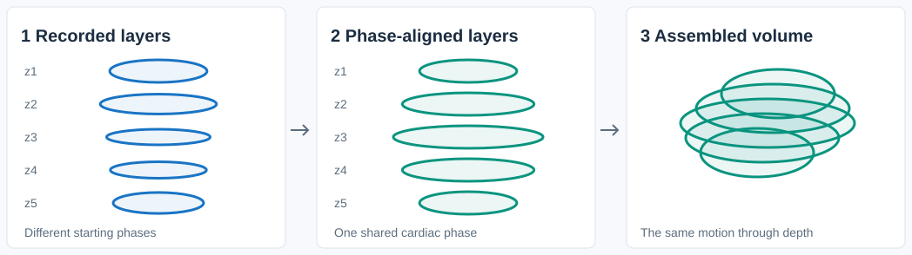
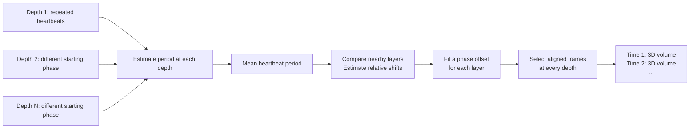

# Retrospective cardiac gating for 4D zebrafish light-sheet microscopy

MATLAB code for **retrospective cardiac gating**, also described as post-acquisition heartbeat synchronization. It aligns time-lapse recordings from successive depths in light-sheet fluorescence microscopy (LSFM), also known as selective plane illumination microscopy (SPIM), to reconstruct a **pseudo-3D zebrafish embryo heart over time**.

At each depth, the microscope records several heartbeats before moving to the next layer. This project estimates the heartbeat period and the temporal offsets between layers, selects aligned image sequences, and assembles one 3D TIFF volume per time state.

## How it works

The recordings start at different cardiac phases. Similar motion in nearby layers provides a temporal reference for aligning them. The resulting volumes combine images acquired at different times, assuming repeatable cardiac motion throughout the scan.






For an aligned time state `k`, the reconstructed volume takes frame `t(i) + k` from layer `i`, where `t(i)` is that layer's estimated integer-frame offset. It does not interpolate images or perform spatial registration.

## Requirements

- **MATLAB**
- **Parallel Computing Toolbox (optional)**

## Steps

### Arrange your input data first

Set `lsSourcePath` to a folder with **one subfolder per depth**, named `1`, `2`, …, `numOfSlice` in the desired z order. Each subfolder must contain a time sequence of **single-page, grayscale `.tif` files**.

```text
C:\example_data\light_sheet\       ← lsSourcePath
├── 1\                            ← first depth
│   ├── 0001.tif                   ← first acquired frame
│   ├── 0002.tif
│   └── ...
├── 2\                            ← second depth
│   ├── 0001.tif
│   ├── 0002.tif
│   └── ...
└── 10\                           ← example last depth
    └── ...
```

Input requirements:

- Frame filenames must sort into acquisition order. Use consistent zero padding: `0001.tif`, `0002.tif`, … . The code uses `dir()` order, not timestamps or natural-number sorting; `1.tif`, `10.tif`, `2.tif` is unsuitable.
- Use matching image dimensions across all frames and depths, and a common frame interval. The core reads only `.tif`; it does not unpack multipage recordings or accept RGB images as time sequences.
- Supply the same number of frames at each depth and set `numOfImage` accordingly. The estimators read **every `.tif` in each folder**, even if `numOfImage` is smaller. Keep unrelated TIFFs outside these folders.
- `uint16` grayscale input is the intended convention. Alignment and volume assembly write `uint16`; they do not preserve arbitrary input types or microscope metadata.
- Record several complete beats. With `B = floor(t_p / h_T) + 1`, the phase step checks for at least `3*B - 1` frames. To allow every candidate shift to compare the full window, provide at least `3*B - 1 + floor(B/2)` frames. The historical matching code skips out-of-range frames in the second sequence; it does not normalize for a shortened comparison.
- The requested aligned sequence must also fit: `t(i) + timePointNum <= numOfImage` for every depth.


### Run the reconstruction

1. Open MATLAB and set its current folder to this repository's root.
2. Edit [STEP1_init.m](STEP1_init.m). Replace both example paths and the acquisition/heartbeat settings with values for your recording.
3. Run:

   ```matlab
   ls_reconstruct
   ```

The script runs these five steps in order:

| File | Purpose | Saved result |
| --- | --- | --- |
| [STEP1_init.m](STEP1_init.m) | Configure paths, acquisition settings, search bounds, and output options | Creates `ls_recon_para.mat` |
| [STEP2_compute_period.m](STEP2_compute_period.m) | Estimate a period at each layer and take their arithmetic mean | `t_p_candidate`, `t_p` |
| [STEP3_compute_phase.m](STEP3_compute_phase.m) | Measure relative shifts and fit layer offsets | `shiftList`, `t`, `timePointNum` |
| [STEP4_align_slices.m](STEP4_align_slices.m) | Select the contiguous aligned frames at each layer | `bySlice/`, `bySliceDir` |
| [STEP5_assemble_xyzt.m](STEP5_assemble_xyzt.m) | Group frames by time and assemble z stacks | Optional `byState/` and `xyzt/` |

You can also run the five scripts individually in this order. They share a generated `ls_recon_para.mat` in the root; later steps load it rather than rereading settings from `STEP1_init.m`. Initialization replaces it, so rerunning STEP1 discards saved estimates. Keep a copy with your results if you need a record of a run, and use separate repository copies for simultaneous runs. Each step clears the MATLAB workspace and closes figures.

### Settings list

| Setting | Meaning |
| --- | --- |
| `lsSourcePath` | Absolute path to the arranged input folders |
| `outputPath` | Dedicated reconstruction destination, separate from the input |
| `numOfSlice` | Number of depth folders; at least 3 |
| `numOfImage` | Recorded frames per depth; match the actual TIFF count |
| `h_T` | Time between consecutive frames, in milliseconds; include acquisition gaps |
| `systolicPoint_1st`, `systolicPoint_4st` | One-based frame indices of the first and fourth identified systolic events in a representative recording; they span three complete cycles |
| `numOfPeriod` | Number of cardiac periods to export |
| `maxSliceConsidered` | Maximum depth-index separation used in pair matching |
| `periodScaleLow`, `periodScaleHigh`, `periodMargin` | Define the search interval around the manually estimated period; margin is in ms |
| `phaseWeight` | Base multiplier of pair rows in the weighted phase fit |
| `useParallel` | Enable parallel period and pair-shift estimation; default `false` |
| `saveByState`, `saveVolumes` | Save time-state folders and/or multipage TIFF volumes; at least one must be `true` |
| `mirrorXY` | Flip image columns left-to-right in the volume output only |
| `flipZ` | Reverse z-page order in the volume output only |
| `overwriteOutput` | Allow STEP4 to delete an existing output root; historical default is `true` |


### Outputs

```text
outputPath/
├── bySlice/                      always written
│   ├── 1/0001.tif, 0002.tif, ...  aligned sequence at depth 1
│   └── ...
├── byState/                      when saveByState = true
│   ├── 0001/slice_1.tif, slice_2.tif, ...
│   └── ...
└── xyzt/                         when saveVolumes = true
    ├── state_0001.tif            one TIFF page per depth
    ├── state_0002.tif
    └── ...
```

- **x** is the image column; **y** is the row; **z** is the TIFF page; **t** is the state filename index. MATLAB arrays are `[height, width, depth]`, or `[y, x, z]`.
- The number of states is `floor(numOfPeriod * floor(t_p / h_T))`. Adjacent states retain the acquired frame interval `h_T`; no temporal resampling is performed.
- The first layer defines phase zero. State 1 is not automatically a named biological event such as systole.
- With both orientation flags `false`, page `i` is layer `i` in its acquired orientation. `mirrorXY` flips columns, and `flipZ` reverses page order. Neither flag changes `bySlice` or `byState`.
- TIFFs do not encode the scan's z spacing or a calibrated time axis. Retain acquisition metadata separately.


## Repository map

- Root scripts: the five-step light-sheet reconstruction and its runner.
- [utils/](utils/README.md): preserved numerical helpers, TIFF reader, and documented historical utilities.
- [preprocessing/](preprocessing/README.md): optional copying, renumbering, and TIFF-to-frame conversion, never called by the core runner.
- [PLOSCompBio/](PLOSCompBio/README.md): historical light-sheet/light-field synchronization and registration scripts, plus their archived parameter files.


## Contributors

- [aaronzq](https://github.com/aaronzq)
- [Ruipeng-Nyx](https://github.com/Ruipeng-Nyx)

---

This synchronization code is adapted from Lee et al. (2016), [4-Dimensional light-sheet microscopy to elucidate shear stress modulation of cardiac trabeculation](https://doi.org/10.1172/JCI83496). 

The scripts in `PLOSCompBio/` are associated with Wang et al. (2021), [A hybrid of light-field and light-sheet imaging to study myocardial function and intracardiac blood flow during zebrafish development](https://doi.org/10.1371/journal.pcbi.1009175). The study used retrospective gating to synchronize myocardial recordings with light-field imaging of blood cells.
